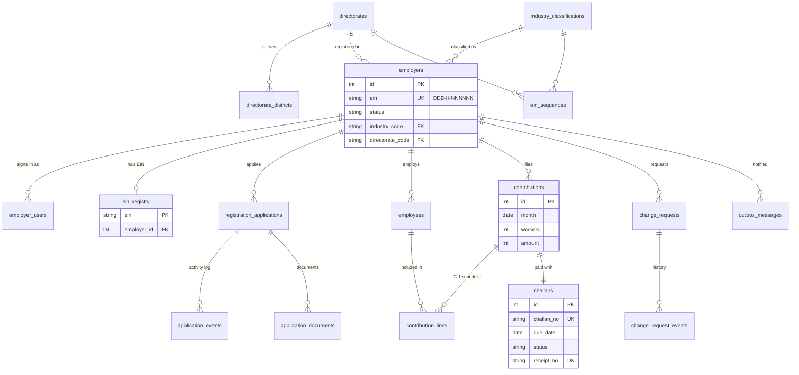

# Entity Relationship Diagram

GitHub and VS Code (with a Mermaid extension) render this diagram.

Not linked by foreign key: `admin_users`, `audit_log` (refers to any entity by name + id), `one_time_codes`.
